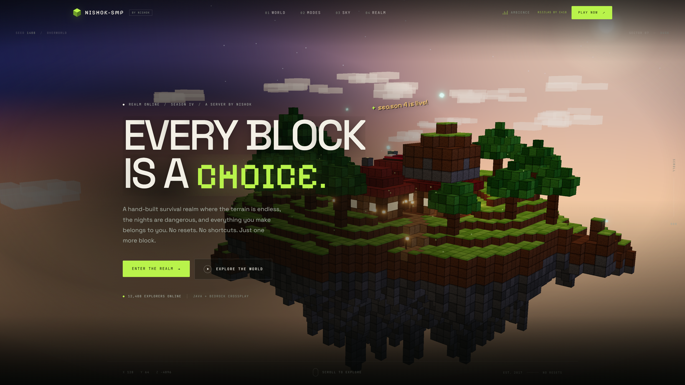
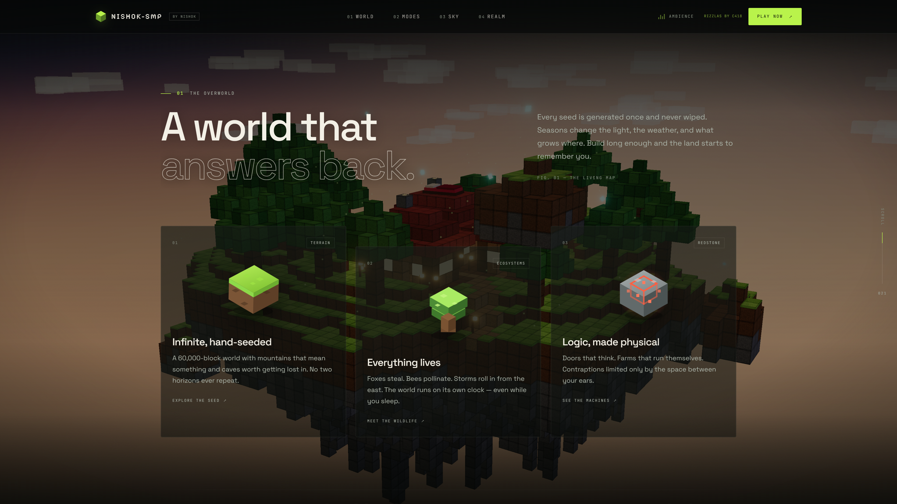
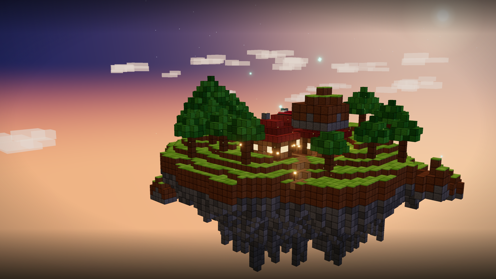
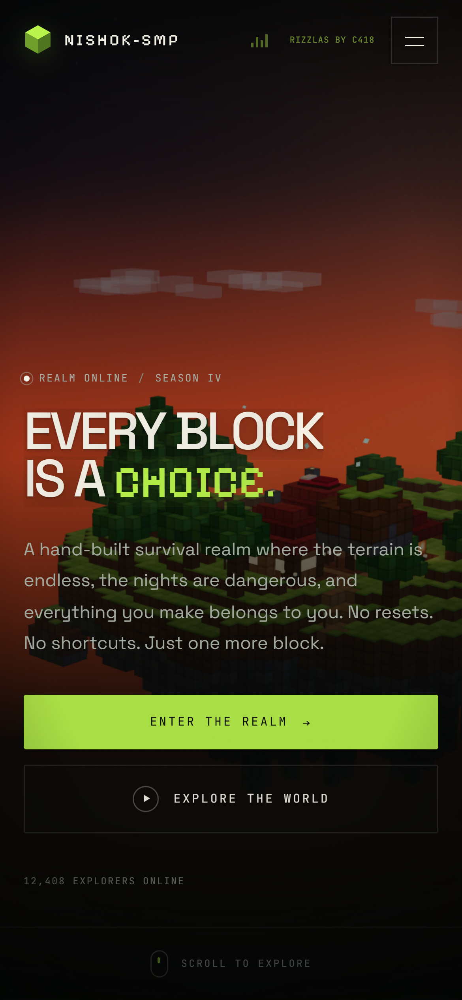
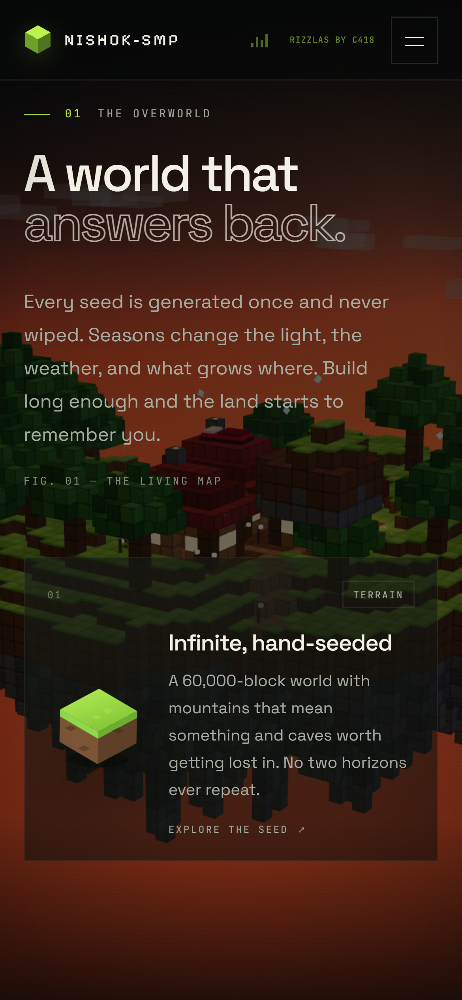
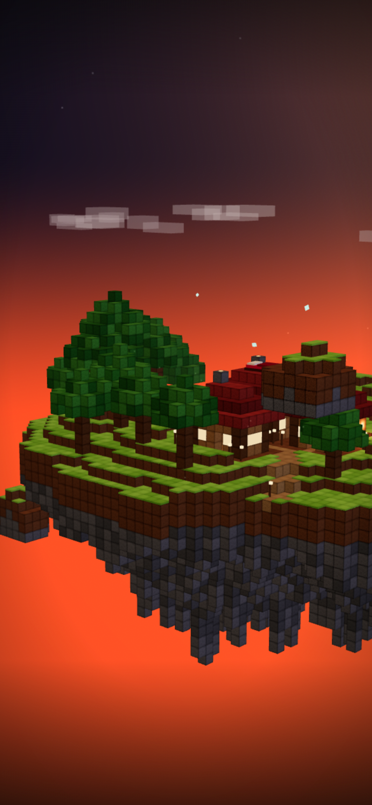

# ⛏️ MINECRAFT-SMP-WEBSITE

A cinematic Minecraft-inspired website featuring an interactive voxel world, immersive visuals, and ambient music.

---

## 🌍 About

NISHOK-SMP is a Minecraft SMP website built to capture the spirit of exploration, civilization-building, and multiplayer adventures.

The project combines cinematic visuals, an interactive voxel environment, and atmospheric sound to create a unique digital experience.

## 🌐 Live Website

**[Visit NISHOK-SMP](https://minecraft-smp-website.vercel.app/)**

## ✨ Features

* 🌎 **Interactive Voxel World** — A Minecraft-inspired environment brought to life through real-time rendering.
* 🎬 **Cinematic Experience** — Immersive visuals, smooth animations, and modern design.
* 🎵 **Ambient Music** — Toggleable background music with looping playback and smooth fade-in/fade-out transitions.
* 🏰 **Civilization Building** — A visual identity inspired by collaborative world-building.
* 🧭 **Exploration & Adventure** — Inspired by discovery and creativity.
* 📱 **Responsive Interface** — Designed for desktop and mobile screens.
* 🌿 **Minimal Aesthetic** — Clean typography, subtle green accents, and an atmospheric interface.

## 📸 Screenshots

## 🖥️ Desktop Experience

<table> <tr> <td align="center" width="50%"> <strong>Homepage</strong><br><br>  </td> <td align="center" width="50%"> <strong>Voxel World Section</strong><br><br>  </td> </tr> <tr> <td align="center" colspan="2"> <strong>Interactive Voxel World</strong><br><br>  </td> </tr> </table>

## 📱 Mobile Experience

<table> <tr> <td align="center" width="33%"> <strong>Homepage</strong><br>  </td> <td align="center" width="33%"> <strong>Voxel Section</strong><br>  </td> <td align="center" width="33%"> <strong>Voxel World</strong><br>  </td> </tr> </table>

## 🛠️ Built With

* JavaScript
* Vite
* HTML5
* CSS3

## 🚀 Getting Started

### Prerequisites

* [Node.js](https://nodejs.org/)
* npm

### Installation

**1. Clone the repository**

```bash
git clone https://github.com/nishok2008/minecraft-smp-website.git
cd minecraft-smp-website
npm install
npm run dev
```

Open the local URL displayed in your terminal.

### Production Build

```bash
npm run build
npm run preview
```

## 🎵 Ambient Music

The website features an interactive ambience control that lets visitors enable or disable background music.

* **Looping Playback** — Continuous ambient sound.
* **Smooth Transitions** — Gradual fade-in and fade-out effects.
* **User Control** — Toggle ambience on or off.
* **Static Audio Asset** — Stored in `public/audio/`.

*Audio playback may require user interaction due to browser autoplay restrictions.*

## 🗺️ Project Status

🚧 **Under Development**

The website continues to evolve with improvements to its visuals, interactive environment, and overall user experience.

## 🤝 Contributing

Contributions, suggestions, and improvements are welcome!

1. Fork the repository.
2. Clone your fork.
3. Create a branch for your changes.
4. Make and test your changes.
5. Commit and push your changes.
6. Open a Pull Request.

### Guidelines

* Keep code clean, readable, and organized.
* Follow the existing coding style.
* Test changes before submitting.
* Avoid unrelated changes.
* Be respectful and constructive.

### Reporting Issues

Found a bug or have an idea? Open a [GitHub Issue](https://github.com/nishok2008/minecraft-smp-website/issues).

## 📜 License

No license has been specified yet. Please contact the project owner before reusing or redistributing the code.

---

<p align="center">
  <strong>Built with creativity. Inspired by Minecraft.</strong>
  <br>
  ⛏️ NISHOK-SMP
</p>
